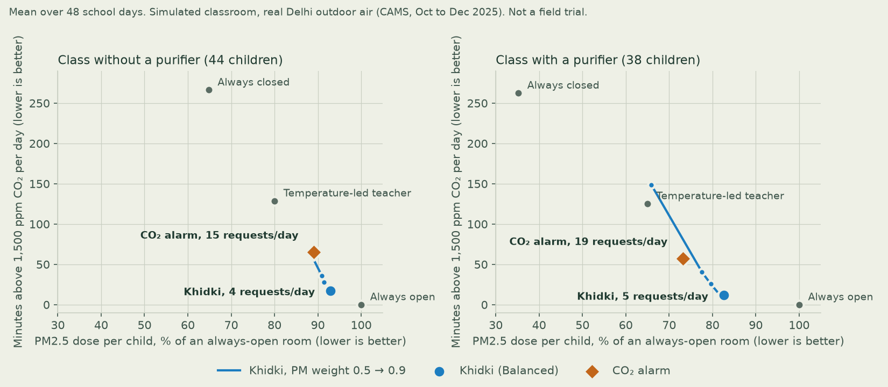

# Benchmark

> **Simulation on a modelled classroom driven by real outdoor air (CAMS via Open-Meteo, East Delhi, school days 15 Oct to 19 Dec 2025). Not a field trial.**

Generated by `python tasks.py bench`. Every policy runs on the same true room (whose physics differ from the
defaults Khidki plans with), at 1-minute resolution, over every cached school day. Khidki and the CO₂ alarm get
the same teacher, who acts on a request 70% of the time after 1 to 3 minutes. Khidki re-plans every 30
minutes and counts every request against its daily budget of 6, including ones the teacher ignored.

## Class without a purifier (44 children)

| Policy | PM2.5 dose (% of always open) | Min > 1,500 ppm | Min > 1,000 ppm | Peak CO₂ | Cold exposure (°C·min) | Requests to teacher |
|---|---|---|---|---|---|---|
| Always closed | 64.8 | 266.3 | 277.2 | 4075 | 0.0 | 0.0 |
| Always open | 100.0 | 0.0 | 0.0 | 880 | 205.7 | 1.0 |
| CO₂ alarm | 89.1 | 65.3 | 220.3 | 2181 | 80.6 | 14.9 |
| Temperature-led teacher | 80.0 | 128.7 | 142.5 | 3105 | 0.0 | 1.0 |
| Khidki | 92.9 | 17.3 | 90.4 | 1713 | 86.3 | 4.0 |
| Khidki, teacher always acts | 94.6 | 1.6 | 75.2 | 1354 | 91.1 | 3.7 |
| Khidki, PM weight 0.6 | 92.4 | 19.2 | 105.2 | 1897 | 76.0 | 4.9 |
| Khidki, PM weight 0.7 | 91.4 | 27.6 | 122.7 | 2013 | 67.3 | 5.0 |
| Khidki, PM weight 0.8 | 90.9 | 36.2 | 133.6 | 2095 | 58.9 | 5.2 |
| Khidki, PM weight 0.9 | 88.4 | 62.8 | 145.2 | 2385 | 34.2 | 5.4 |

**Khidki (Balanced) vs CO₂ alarm, day by day:** fewer minutes above 1,500 ppm on 44 of 48 days (tied on 0); median PM2.5 difference +4.2 points of an always-open dose; median requests 0.28× the alarm's.
Khidki Pareto-dominates the alarm (better or equal on both PM and CO₂) on 1 of 48 days; the alarm dominates Khidki on 1.

## Class with a purifier (38 children)

| Policy | PM2.5 dose (% of always open) | Min > 1,500 ppm | Min > 1,000 ppm | Peak CO₂ | Cold exposure (°C·min) | Requests to teacher |
|---|---|---|---|---|---|---|
| Always closed | 35.2 | 262.5 | 275.5 | 3600 | 0.0 | 4.4 |
| Always open | 100.0 | 0.0 | 0.0 | 828 | 205.7 | 5.4 |
| CO₂ alarm | 73.2 | 57.4 | 211.3 | 2057 | 70.6 | 18.6 |
| Temperature-led teacher | 65.0 | 125.3 | 139.7 | 2759 | 0.0 | 5.4 |
| Khidki | 82.6 | 11.7 | 251.0 | 1609 | 73.3 | 5.1 |
| Khidki, teacher always acts | 82.8 | 2.4 | 260.2 | 1342 | 75.5 | 5.1 |
| Khidki, PM weight 0.6 | 81.8 | 11.5 | 247.8 | 1621 | 66.5 | 5.0 |
| Khidki, PM weight 0.7 | 79.6 | 25.8 | 242.2 | 1907 | 55.4 | 5.4 |
| Khidki, PM weight 0.8 | 77.6 | 40.3 | 252.7 | 2068 | 39.8 | 5.9 |
| Khidki, PM weight 0.9 | 65.9 | 148.6 | 258.1 | 2186 | 35.5 | 5.7 |

**Khidki (Balanced) vs CO₂ alarm, day by day:** fewer minutes above 1,500 ppm on 46 of 48 days (tied on 0); median PM2.5 difference +10.0 points of an always-open dose; median requests 0.3× the alarm's.
Khidki Pareto-dominates the alarm (better or equal on both PM and CO₂) on 0 of 48 days; the alarm dominates Khidki on 1.

## What this does and doesn't show

- **Khidki's win is CO₂ and attention, not smog.** Against a CO₂ alarm, Khidki cuts the time a class spends
  above 1,500 ppm by roughly three quarters and asks the teacher about a quarter as often, for a few points more
  PM2.5. Turning up the PM weight moves Khidki along its curve until it matches the alarm on both PM and CO₂,
  still with about a third of the requests and much less cold air. It never clearly dominates the alarm on PM
  and CO₂ together.
- **Why the PM lever is small without a purifier.** Forty-odd children need about 3.3 air changes an hour to stay
  under 1,500 ppm, and at that ventilation indoor PM is already ~94% of a fully open room. Timing helps a
  little (close during spikes, purge in recess); a purifier with shut windows is the big lever, and Khidki
  coordinates the two.
- **CAMS reads Delhi low.** The replay days are uncorrected CAMS model values (median 24-hour PM2.5 91 µg/m³), so
  absolute doses are understated; the comparisons are relative.
- **Not a field trial.** The classroom, sensors and teacher are simulated. Real classrooms will differ.
